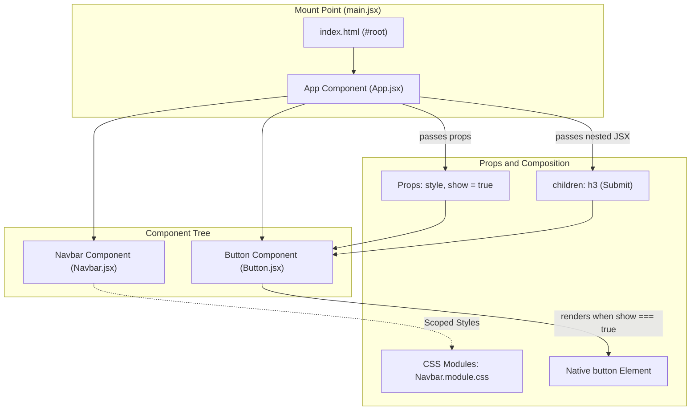

# Components and Props

Welcome to **Components and Props**! In React, everything is built from independent, reusable pieces of user interface called **Components**. Components let you split the UI into modular, isolated pieces, and think about each piece in isolation. To make components dynamic and reusable, React uses **Props** (short for properties) to pass data from parent components down to child components.

This project, built with **React 19** and **Vite**, demonstrates how to build modular components, pass custom props, forward native HTML attributes, leverage the special `children` prop, perform conditional rendering, and apply multiple styling strategies (including CSS Modules and inline styles).

---

## 📁 Directory Structure

Below is the directory structure for the `04componentsprops` project:

```text
04componentsprops/
├── public/
│   ├── favicon.svg
│   └── icons.svg
├── src/
│   ├── assets/
│   │   ├── hero.png
│   │   ├── react.svg
│   │   └── vite.svg
│   ├── components/
│   │   ├── Button.jsx
│   │   └── Navbar.jsx
│   ├── App.jsx
│   ├── index.css
│   ├── main.jsx
│   └── Navbar.module.css
├── .gitignore
├── eslint.config.js
├── index.html
├── package.json
├── package-lock.json
├── README.md
└── vite.config.js
```

---

## 📑 File & Folder Breakdown

Here is an overview of the files and folders in this project:

| File / Folder | Type | Description |
| :--- | :--- | :--- |
| `public/` | Directory | Static assets (e.g., `favicon.svg`, `icons.svg`) served directly without bundler transformation. |
| `src/assets/` | Directory | Images and SVG files bundled and optimized by Vite when imported into components. |
| `src/components/Navbar.jsx` | File | Navigation bar component demonstrating arrow-function component syntax and CSS Module styling. |
| `src/components/Button.jsx` | File | Flexible button component demonstrating prop destructuring, default values, the `children` prop, rest/spread attributes, and JSDoc typing. |
| `src/App.jsx` | File | Root application component composing `Navbar` and `Button` while passing custom props and nested JSX. |
| `src/Navbar.module.css` | File | CSS Module providing scoped styles specifically for the `Navbar` component. |
| `src/index.css` | File | Global stylesheet applying baseline reset styles (`margin: 0`, `box-sizing: border-box`). |
| `src/main.jsx` | File | Entry point initializing React with `StrictMode` and mounting `<App />` into the `#root` DOM element. |
| `index.html` | File | Host HTML file containing `<div id="root"></div>` and the module script tag. |
| `package.json` | File | Project manifest detailing dependencies (`react`, `react-dom` 19.x) and build/dev scripts. |
| `vite.config.js` | File | Vite configuration file integrating the official `@vitejs/plugin-react` plugin. |
| `README.md` | File | Comprehensive documentation and guide for components, props, and styling patterns. |

---

## 🧠 Key React Concepts Covered

### 1. What Are React Components?
React components are regular JavaScript functions that return JSX (JavaScript XML). They describe what the user interface should look like at any given time.

There are two primary ways to declare functional components:
- **Function Declarations**:
  ```jsx
  function Button(props) {
    return <button>{props.children}</button>;
  }
  ```
- **Arrow Functions**:
  ```jsx
  const Navbar = () => {
    return <nav>Navbar</nav>;
  };
  ```

> [!NOTE]
> Component names in React **must always start with a capital letter** (e.g., `Navbar`, `Button`, `App`). Lowercase tags (like `<button>`, `<nav>`, `<div>`) are treated by React as standard HTML tags.

---

### 2. Understanding Props (Properties)
Props are the mechanism React uses to pass data down the component tree—from parent to child.

- **Unidirectional Data Flow**: Data flows in one direction only (top to bottom). A child component receives props from its parent and cannot modify them directly (props are **read-only / immutable**).
- **Passing Props**: Props are passed as attributes in JSX:
  ```jsx
  // Passing a boolean shorthand (equivalent to show={true})
  // Passing an object as a prop (style={{ ... }})
  <Button
    style={{ backgroundColor: "blue", borderRadius: "16px", color: "white", border: "none", padding: "8px 16px" }}
    show
  >
    <h3>Submit</h3>
  </Button>
  ```

---

### 3. Prop Destructuring & Default Values
Rather than accessing properties via `props.show` or `props.children`, modern React idiomatic code uses ES6 parameter destructuring:

```jsx
function Button({ show = false, children, ...props }) {
  // ...
}
```

- **`show = false`**: Provides a default fallback value if the parent does not explicitly pass the `show` prop.
- **`children`**: Captures any JSX or text passed between opening and closing tags.
- **`...props`**: The **rest pattern** captures all remaining props (e.g., `style`, `onClick`, `id`, `disabled`, `type`, `aria-*`) into a single object.

---

### 4. The Special `children` Prop
React reserves the `children` prop for content nested between a component's opening and closing tags:

```jsx
// In App.jsx:
<Button show>
  <h3>Submit</h3>
</Button>
```

Inside `Button.jsx`, `{children}` represents whatever was nested:
```jsx
function Button({ show = false, children, ...props }) {
  return (
    <>
      {show && (
        <button {...props}>
          {children}
        </button>
      )}
    </>
  );
}
```

> [!TIP]
> **Component Composition:**
> Using `children` allows components to act as generic "containers" (or layout slots). A `Button` component doesn't need to know whether its inner content is plain text, an icon, an `<h3>`, or another component.

---

### 5. Prop Spreading (`...props`) for Native HTML Attributes
When building reusable wrapper components like custom buttons, inputs, or cards, forwarding native attributes is essential:

```jsx
<button {...props}>
  {children}
</button>
```

When `App.jsx` passes `style={{ backgroundColor: "blue", ... }}` or an `onClick={handleClick}`, the spread operator (`...props`) automatically unpacks them directly onto the underlying `<button>` DOM element. This pattern keeps wrapper components flexible without having to manually enumerate every valid HTML attribute.

---

### 6. Conditional Rendering with Logical AND (`&&`)
In `Button.jsx`, the component uses the JavaScript short-circuit logical AND (`&&`) operator:

```jsx
{show && <button {...props}>{children}</button>}
```

- If `show` is `true`, the expression evaluates to the JSX `<button ...>`, rendering the button.
- If `show` is `false`, the expression evaluates to `false`, and React renders nothing.

> [!WARNING]
> Be cautious when short-circuiting with numbers! If the condition evaluates to `0`, React will render `0` as text onto the screen rather than hiding the element. For numbers or complex logic, prefer explicit booleans (e.g., `Boolean(count)` or `count > 0 ? <Component /> : null`).

---

### 7. Styling in React: CSS Modules & Inline Styles

This project demonstrates multiple styling paradigms:

#### A. CSS Modules (`Navbar.module.css`)
CSS Modules allow you to write standard CSS while scoping class names locally to the component, preventing accidental style collisions across the application:

```css
/* Navbar.module.css */
nav {
    background-color: black;
    color: white;
    text-align: center;
    position: sticky;
    top: 0;
    width: 100%;
    padding: 8px 16px;
    margin-bottom: 20px;
}
```

Imported and applied in `Navbar.jsx`:
```jsx
import styles from "../Navbar.module.css";

const Navbar = () => {
  return (
    <nav className={styles.nav}>Navbar</nav>
  );
};
```

#### B. Inline Styling (`style={{ ... }}`)
In JSX, inline styles are written as JavaScript objects rather than CSS strings:
```jsx
<Button
  style={{
    backgroundColor: "blue",
    borderRadius: "16px",
    color: "white",
    border: "none",
    padding: "8px 16px"
  }}
  show
>
  <h3>Submit</h3>
</Button>
```
- Keys are written in **camelCase** (e.g., `backgroundColor` instead of `background-color`, `borderRadius` instead of `border-radius`).
- Values are typically strings or numeric pixel values.

#### C. Global Styles (`index.css`)
Applied globally in `main.jsx` to establish consistent layout defaults across all elements:
```css
* {
  margin: 0;
  padding: 0;
  box-sizing: border-box;
}
```

---

### 8. Enhancing JavaScript with JSDoc Type Annotations
Even in standard JavaScript files (`.jsx`), you can leverage TypeScript-grade type checking and IDE autocomplete using **JSDoc**:

```javascript
/**
 * @typedef {React.ComponentPropsWithRef<"button"> & {
 * show: boolean
 * }} ButtonProps
 */

/**
 * @param {ButtonProps} props
 */
function Button({ show = false, children, ...props }) {
    // ...
}
```

- `React.ComponentPropsWithRef<"button">`: Inherits all standard HTML button attributes and events (`onClick`, `disabled`, `type`, `aria-label`, etc.).
- `& { show: boolean }`: Extends the button attributes with our custom required or optional `show` prop.
- When consuming `<Button />` in `App.jsx`, your editor provides rich IntelliSense autocomplete and inline documentation!

---

## 🔍 Component Architecture & Data Flow

Below is an overview of how components, props, and styles interact in this project:



---

## 🛠️ Setup Guide (VS Code + Node.js)

Before running the app, ensure your development environment is set up:

### 1. Install Node.js
- Download and install the latest **LTS (Long Term Support)** version of Node.js from [nodejs.org](https://nodejs.org/).
- Verify your installation by running:
  ```bash
  node -v
  npm -v
  ```

### 2. Install Visual Studio Code (VS Code)
- Download and install VS Code from [code.visualstudio.com](https://code.visualstudio.com/).
- **Recommended VS Code Extensions**:
  - **ES7+ React/Redux/React-Native snippets**: Fast shortcuts for boilerplate component creation.
  - **Prettier - Code Formatter**: Automatically formats JSX and CSS on save.
  - **ESLint**: Catches syntax issues and enforces best practices.
  - **Auto Rename Tag**: Automatically renames matching opening/closing JSX tags.

---

## 🚀 Setup & Running This App

Follow these simple steps to run this project locally:

1. **Navigate to the project folder:**
   ```bash
   cd 04componentsprops
   ```

2. **Install project dependencies:**
   ```bash
   npm install
   ```

3. **Start the development server:**
   ```bash
   npm run dev
   ```

4. **View the application:**
   - Open your browser and navigate to the local URL displayed in the terminal (typically `http://localhost:5173/`).

### Available Scripts

| Command | Action |
| :--- | :--- |
| `npm run dev` | Launches the local Vite development server with Hot Module Replacement (HMR). |
| `npm run build` | Compiles and bundles production-ready assets into the `dist/` folder. |
| `npm run preview` | Locally serves and previews the production build. |
| `npm run lint` | Runs ESLint to check for code quality and syntax issues. |

---

## 🏋️ Practice Challenge: Multi-Variant Button Component

> **Difficulty**: `Medium to Advanced`  
> **Goal**: Upgrade the existing `<Button />` component into a production-ready, multi-variant design system button that supports distinct visual styles through a `variant` prop.

### 📋 Challenge Requirements

1. **Support 4 Core Variants**:
   Add a `variant` prop to `<Button />` supporting the following styles:
   - **`"primary"`** *(Default)*: High-emphasis solid button (e.g., vibrant blue background, white text).
   - **`"secondary"`**: Muted / neutral button (e.g., soft gray background, dark text) for secondary actions like "Cancel" or "Back".
   - **`"outline"`**: Ghost / bordered button (transparent background with a colored border and text) for subtle tertiary actions.
   - **`"danger"`**: Destructive action button (crimson/red background or red border with white text) for risky actions like "Delete" or "Remove".

2. **Default Prop Value**:
   - Ensure `variant` defaults to `"primary"` if no variant is explicitly specified:
     ```jsx
     function Button({ show = true, variant = "primary", children, ...props }) { ... }
     ```

3. **Update JSDoc Type Definitions**:
   - Update the `@typedef` annotation in `Button.jsx` to provide IntelliSense union autocomplete in your editor:
     ```javascript
     /**
      * @typedef {React.ComponentPropsWithRef<"button"> & {
      *   show?: boolean,
      *   variant?: "primary" | "secondary" | "outline" | "danger"
      * }} ButtonProps
      */
     ```

4. **Clean Styling Strategy**:
   - You can implement variants using either:
     - **Option A (Recommended - CSS Modules)**: Create `src/components/Button.module.css` with classes like `.primary`, `.secondary`, `.outline`, and `.danger`, and compose class names dynamically (`className={`${styles.btn} ${styles[variant]} ${className || ""}`.trim()}`).
     - **Option B (Style Mapping Object)**: Define a dictionary of inline styles (`VARIANT_STYLES[variant]`) and merge it with any incoming `style` prop via the spread operator.

5. **Maintain Flexibility & Native Attribute Forwarding**:
   - Ensure `children`, `style`, `className`, `disabled`, and event handlers like `onClick` continue to be forwarded to the native `<button>` element via `...props`.

---

### 🧪 Expected Usage Example

Once completed, your `<App />` component should be able to render buttons like this:

```jsx
import Button from "./components/Button";
import Navbar from "./components/Navbar";

function App() {
  return (
    <>
      <Navbar />
      <div style={{ display: "flex", gap: "12px", padding: "20px", flexWrap: "wrap" }}>
        {/* 1. Primary Variant */}
        <Button variant="primary" show onClick={() => alert("Primary Clicked!")}>
          Primary Action
        </Button>

        {/* 2. Secondary Variant */}
        <Button variant="secondary" show>
          Cancel
        </Button>

        {/* 3. Outline Variant */}
        <Button variant="outline" show>
          Learn More
        </Button>

        {/* 4. Danger Variant */}
        <Button variant="danger" show>
          Delete Account
        </Button>

        {/* 5. Disabled State Test */}
        <Button variant="primary" show disabled style={{ opacity: 0.6, cursor: "not-allowed" }}>
          Disabled Button
        </Button>
      </div>
    </>
  );
}

export default App;
```

---

### 🌟 Bonus Stretch Goals (Advanced)
- **Size Prop**: Add support for a `size` prop (`"sm" | "md" | "lg"`) controlling padding and font size.
- **Icon Support**: Add `leftIcon` or `rightIcon` props to render icons alongside the button text.
- **Loading State**: Add an `isLoading` boolean prop that shows a spinner and disables button clicks.

---

## 🎯 Conclusion

In this chapter, you learned the core foundational concepts that empower all React applications:
- How functional components encapsulate reusable pieces of user interface.
- How props enable clean, unidirectional data flow from parent to child.
- How parameter destructuring and default values make component code concise and readable.
- How the `children` prop and `...props` forwarding unlock flexible component composition.
- How to conditionally render elements with `{show && ...}`.
- How to style components using both scoped CSS Modules and dynamic inline styles.
- How to use JSDoc annotations to get TypeScript-like autocomplete in pure JavaScript.

---

<p style="text-align: center;">Made with 💖 & 🍵 by <a style="text-decoration: none;" href="https://www.youtube.com/channel/UCBi8v2w8B7174Y76QcYysiA?sub_confirmation=1" target="_blank">CodeWithLaksh</a></p>
